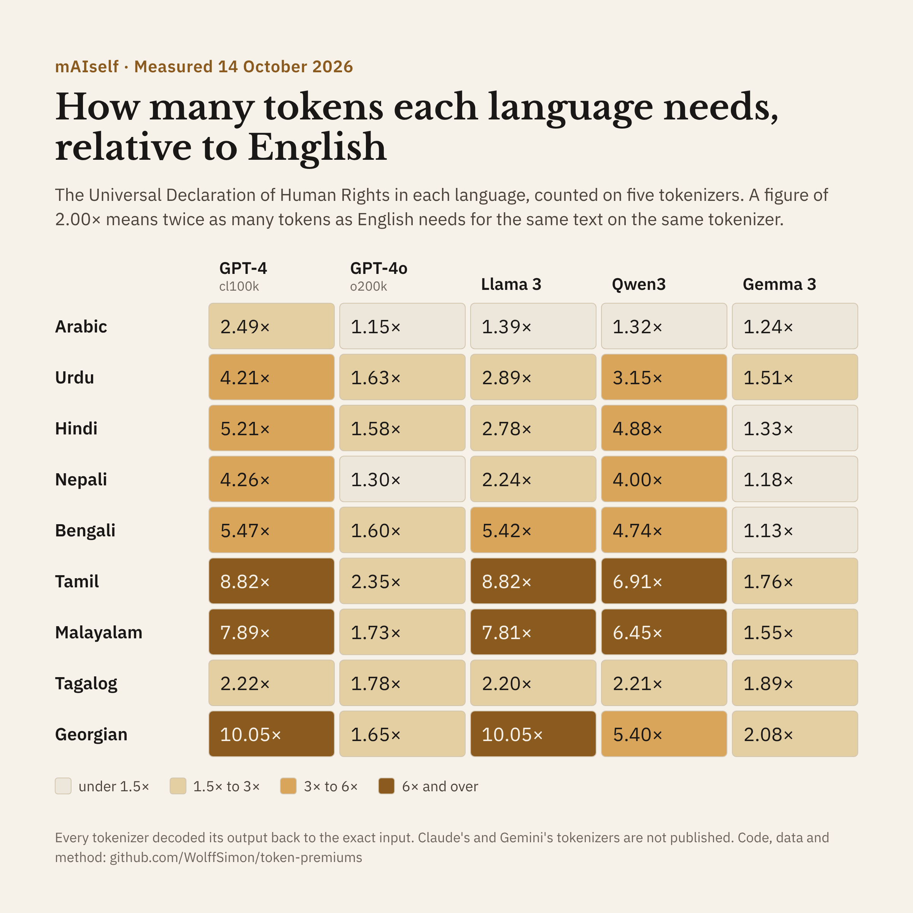

# Token cost by language on five tokenizers

Matthew Wolff Simon of mAIself counted the tokens that five published tokenizers need for the Universal Declaration of Human Rights in ten languages. Each count is divided by the count for English on the same tokenizer. A figure of 2.00 means the language takes twice as many tokens as English for the same text.

Measured on 14 October 2026. Rerun on 16 October 2026 with identical output.



## Result

| Language | GPT-4 (cl100k) | GPT-4o (o200k) | Llama 3 | Qwen3 | Gemma 3 |
|---|---|---|---|---|---|
| Arabic (MSA) | 2.49 | 1.15 | 1.39 | 1.32 | 1.24 |
| Urdu | 4.21 | 1.63 | 2.89 | 3.15 | 1.51 |
| Hindi | 5.21 | 1.58 | 2.78 | 4.88 | 1.33 |
| Nepali | 4.26 | 1.30 | 2.24 | 4.00 | 1.18 |
| Bengali | 5.47 | 1.60 | 5.42 | 4.74 | 1.13 |
| Tamil | 8.82 | 2.35 | 8.82 | 6.91 | 1.76 |
| Malayalam | 7.89 | 1.73 | 7.81 | 6.45 | 1.55 |
| Tagalog | 2.22 | 1.78 | 2.20 | 2.21 | 1.89 |
| Georgian | 10.05 | 1.65 | 10.05 | 5.40 | 2.08 |
| English tokens (baseline) | 2207 | 2209 | 2207 | 2228 | 2404 |

Every tokenizer decoded its output back to the exact input text in every language.

## Why it matters

Models are priced by the token and generate one token at a time. A language that needs more tokens for the same content costs more per answer, takes longer to answer, and fits less text into the same context window. The table shows that the size of that premium depends heavily on the tokenizer. Hindi needs 4.88 times as many tokens as English on Qwen3's tokenizer and 1.33 times on Gemma 3's.

## How to reproduce

1. Install Node.js 22 and Python 3, then run `pip install tokenizers==0.23.3`.
2. In this folder, run `npm ci`. This installs the exact versions in package-lock.json: gpt-tokenizer 4.0.0 and @lenml/tokenizer-llama3, -qwen3 and -gemma3 3.7.2.
3. Download the corpus and unpack it into a folder called corpus:

   ```
   mkdir -p corpus
   curl -L -o corpus/udhr2.zip https://raw.githubusercontent.com/nltk/nltk_data/gh-pages/packages/corpora/udhr2.zip
   unzip corpus/udhr2.zip -d corpus
   ```

   The texts are then at corpus/udhr2/eng.txt and so on.
4. Run `node measure_gpt.mjs`. It writes gpt_counts.json for cl100k_base and o200k_base.
5. Run `python3 measure_hf.py`. It writes hf_counts.json for Llama 3, Qwen3 and Gemma 3, using the tokenizer.json files inside the @lenml packages.
6. Run `python3 compute_premiums.py`. It writes premiums.json and premiums.csv, and stops if any tokenizer failed to round-trip.

## Method

- Text: the udhr2 corpus distributed with NLTK, which comes from unicode.org. One complete translation per language. Files used: eng, arb, urd, hin, nep, ben, tam, mal, tgl and kat.
- Every text is normalised to Unicode NFC before counting.
- No special tokens are added.
- The measure is the parity premium of Petrov et al. (NeurIPS 2023), applied to a different parallel text.

## Checks

SHA-256 of the corpus archive:

```
0796c314b09a930c989c6f9d93d226af9af13feccd88496e196c743dd266c7f3  udhr2.zip
```

SHA-256 of each text used:

```
bbb18530dd8470980acb01971a0c5ca3c4dd3b69ba50c9922929211732d08888  eng.txt
19bde677877abd10877503e07871fe4a9d3eacd4e5f5f2d10067cdddc6fdcf19  arb.txt
558349c64fabcd678342ceea7b2338ae0ba42e11fe0753b3466d66f5ed03daba  urd.txt
e006b6e34844b7baa064ae7cbf4bcf998b4424e5ddb82506e38addcadb9f1926  hin.txt
ec0a940b22ced5c52d770dd7c3f87564e9d0d173b6dbd5810cfbb5900265f948  nep.txt
4c87d8da3276274da3c70b24d07877ad591e7d7728514ba69ae69a9368f11285  ben.txt
24ec0d4c16c87c6aace1ef3446a9d12781c9425644e4a42774f7b02b4c643390  tam.txt
07bdc9659ecfe8ed6578f5d0dad47d27e0ccad3c8e42f5e9fc0ffbe11e5ebddb  mal.txt
1813a040102c07b4efc2ee423291ebe957c0300c1f07c8cc1482114713978d3b  tgl.txt
6bd4333945d51550c5e0f4d31b1b2a1b87e9964d2999b9ee3eea8c0b14b2f11d  kat.txt
```

SHA-256 of the tokenizer files:

```
c05a3c2174e9edd5be19dc5a0748c42a9037bec2811ce062728bfd71f8702d78  tokenizer-llama3/models/tokenizer.json
aeb13307a71acd8fe81861d94ad54ab689df773318809eed3cbe794b4492dae4  tokenizer-qwen3/models/tokenizer.json
4667f2089529e8e7657cfb6d1c19910ae71ff5f28aa7ab2ff2763330affad795  tokenizer-gemma3/models/tokenizer.json
```

## Agreement with published figures

- The GPT-4 column is within a fifth of Petrov et al.'s FLORES-200 figures for every language. For example, Georgian is 10.05 against their 9.9, Hindi 5.21 against 4.8 and Arabic 2.49 against 3.0.
- Hindi on Gemma 3 (1.33) and on Qwen3 (4.88) is close to the September 2026 preprint "The Invisible Language Tax" (1.34 and 4.56).
- Llama 3 gives the same counts as cl100k for Tamil, Georgian and English. Llama 3's tokenizer extends OpenAI's cl100k vocabulary, so text in scripts that its extra tokens do not cover tokenizes identically.

## Limits

- Sinhala and Gulf Arabic are not in the corpus. The Arabic here is Modern Standard Arabic.
- Claude's and Gemini's tokenizers are not published, so they were not measured. Gemma 3's tokenizer is often used as a stand-in for Gemini's, which Google has not confirmed.
- The Universal Declaration is formal legal prose. Conversational text may tokenize differently.
- package.json also lists llama3-tokenizer-js 1.2.0, which was installed but not used.

## References

- Petrov, A., La Malfa, E., Torr, P. and Bibi, A. Language Model Tokenizers Introduce Unfairness Between Languages. NeurIPS 2023. https://arxiv.org/abs/2305.15425
- Ahia, O. et al. Do All Languages Cost the Same? Tokenization in the Era of Commercial Language Models. EMNLP 2023. https://arxiv.org/abs/2305.13707
- The Invisible Language Tax. arXiv 2609.39001, September 2026 (preprint).

## Files

- measure_gpt.mjs: counts tokens on cl100k_base and o200k_base.
- measure_hf.py: counts tokens on Llama 3, Qwen3 and Gemma 3.
- compute_premiums.py: divides each count by English's on the same tokenizer.
- package.json and package-lock.json: the pinned Node packages.
- gpt_counts.json and hf_counts.json: raw token counts and round-trip results.
- premiums.json and premiums.csv: the results.
- figures/token_premiums.png: the chart above.

## Licence

The code (measure_gpt.mjs, measure_hf.py, compute_premiums.py, package.json and package-lock.json) is released under the MIT licence; see LICENSE. The data (gpt_counts.json, hf_counts.json, premiums.json and premiums.csv), the text of this README and the chart in figures/ are released under the Creative Commons Attribution 4.0 International licence; see LICENSE-DATA. Copyright 2026 Matthew Wolff Simon.

Suggested credit: Matthew Wolff Simon, mAIself, "Token cost by language on five tokenizers", October 2026.

## About

mAIself is an AI assistant that chooses a model for each question by its language and task. Its line is "AI for the next billion". https://maiself.io
